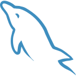

  

  
  
  
  

---

## 🙋‍♂️ About Me

I'm a data scientist who likes to finish things. Every project I build goes the whole way — cleaning raw data, exploring it, training a model, and shipping it as a **live web app** that anyone can try.

- 🔭 Currently building **[ChurnSight](https://churnsight-s5dv.onrender.com)** — customer-review NLP & churn intelligence
- 🌱 Currently learning **LLMs, RAG & MLOps**
- 👯 Open to collaborate on **Data Science & Machine Learning projects**
- 💬 Ask me about **Python, SQL, Machine Learning, A/B Testing, NLP**
- 📫 Reach me at **[akashbaloni10@gmail.com](mailto:akashbaloni10@gmail.com)**
- ⚡ Fun fact: **I deploy every project as a live web app 🚀**

---

## 🚀 Featured Projects

<table>
  <tr>
    <td width="50%" valign="top">
      <h3>📉 ChurnSight</h3>
      
<b>Customer Reviews NLP &amp; Churn Intelligence</b>

      
Turns raw customer reviews into churn signals with NLP, and presents the insights in an interactive web dashboard.

      

        
        
        
        
      

      

        <a href="https://churnsight-s5dv.onrender.com"><b>🌐 Live demo</b></a> ·
        <a href="https://github.com/Akashbaloni?tab=repositories&q=churnsight"><b>💻 Code</b></a>
      

      Hosted on Render's free tier — the app may take ~30 seconds to wake up.
    </td>
    <td width="50%" valign="top">
      <h3>🧪 More projects</h3>
      
Every project is end-to-end: data → analysis → model → deployed app.

      
Explore ML, NLP, SQL and A/B testing work in my repositories.

      

        <a href="https://github.com/Akashbaloni?tab=repositories"><b>📂 Browse all repositories →</b></a>
      

    </td>
  </tr>
  <!--
  ADD MORE PROJECTS: copy this row, fill it in, and remove the comment markers.
  <tr>
    <td width="50%" valign="top">
      <h3>🔹 Project name</h3>
      
<b>One-line tagline</b>

      
What it does and what problem it solves.

      
<a href="LIVE_URL"><b>🌐 Live demo</b></a> · <a href="https://github.com/Akashbaloni/REPO_NAME"><b>💻 Code</b></a>

    </td>
    <td width="50%" valign="top">
      <h3>🔹 Project name</h3>
      
<b>One-line tagline</b>

      
What it does and what problem it solves.

      
<a href="LIVE_URL"><b>🌐 Live demo</b></a> · <a href="https://github.com/Akashbaloni/REPO_NAME"><b>💻 Code</b></a>

    </td>
  </tr>
  -->
</table>

---

## 🛠️ Tech Stack

<table>
  <tr>
    <td align="center" width="170"><b>ML &amp; Data Science</b></td>
    <td>
      &nbsp;
      &nbsp;
      &nbsp;
      &nbsp;
      &nbsp;
      &nbsp;
      &nbsp;
      
    </td>
  </tr>
  <tr>
    <td align="center"><b>Databases</b></td>
    <td>
      &nbsp;
      
    </td>
  </tr>
  <tr>
    <td align="center"><b>Web &amp; Apps</b></td>
    <td>
      &nbsp;
      &nbsp;
      &nbsp;
      &nbsp;
      &nbsp;
      
    </td>
  </tr>
  <tr>
    <td align="center"><b>DevOps &amp; Tools</b></td>
    <td>
      &nbsp;
      &nbsp;
      
    </td>
  </tr>
  <tr>
    <td align="center"><b>Learning now</b></td>
    <td>
      
      
      
    </td>
  </tr>
</table>

---

## 📊 GitHub Stats

  

  
  &nbsp;
  

  

  

  <picture>
    <source media="(prefers-color-scheme: dark)" srcset="./profile/snake-dark.svg" />
    <source media="(prefers-color-scheme: light)" srcset="./profile/snake.svg" />
    
  </picture>

Stats refresh automatically every day via GitHub Actions.

---

  <b>Thanks for stopping by! If you like my work, feel free to ⭐ a repo or <a href="https://linkedin.com/in/akash-baloni">connect on LinkedIn</a>.</b>

