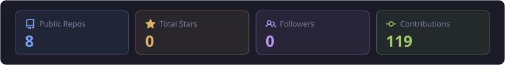
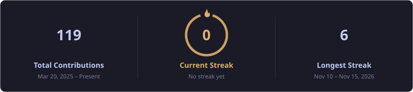
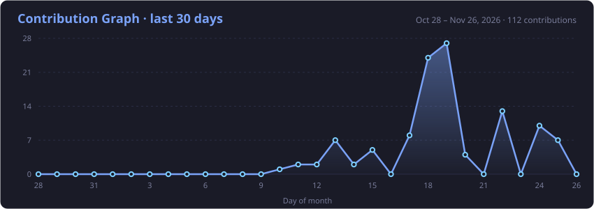

  

  
  
  
  

---

## 🙋‍♂️ About Me

I'm a data scientist who likes to finish things. Every project I build goes the whole way — cleaning raw data, exploring it, training a model, and shipping it as a **live web app** that anyone can try.

- 🔭 Currently building **[ChurnSight](https://churnsight-s5dv.onrender.com)** — Customer 360 intelligence that links reviews (NLP) with orders to explain churn
- 🌱 Currently learning **LLMs, RAG & MLOps**
- 👯 Open to collaborate on **Data Science & Machine Learning projects**
- 💬 Ask me about **Python, SQL, Machine Learning, A/B Testing, NLP**
- 📫 Reach me at **[akashbaloni10@gmail.com](mailto:akashbaloni10@gmail.com)**
- ⚡ Fun fact: **I deploy every project as a live web app 🚀**

---

## 🚀 Featured Projects

<table>
  <tr>
    <td width="50%" valign="top">
      <h3>📉 ChurnSight</h3>
      
<b>Customer 360 · NLP · Churn Intelligence</b>

      
Links what customers <i>say</i> (34k Portuguese reviews) with what they <i>do</i> (96k orders) on the Olist dataset. A fine-tuned <b>BERTimbau</b> classifier reaches <b>0.835 topic macro-F1</b> (vs 0.636 for keyword rules), hybrid search answers questions in English or Portuguese, and rising-issue alerts caught the late-delivery spikes of Nov 2017 and Feb–Mar 2018.

      

        
        
        
        
        
      

      

        <a href="https://churnsight-s5dv.onrender.com"><b>🌐 Live demo</b></a> ·
        <a href="https://github.com/Akashbaloni/churnsight"><b>💻 Code</b></a>
      

    </td>
    <td width="50%" valign="top">
      <h3>🎯 Criteo A/B Test & Uplift</h3>
      
<b>Did the ads bring anyone new?</b>

      
Analysis of a randomized A/B test on <b>13.98M users</b>: SRM, covariate balance and power checks, causal estimates (ITT, CACE) and S/T/X-learner uplift models. Ads lifted visits by <b>+1.07 pp</b> (+27.9%), the most active 20% of users drive 88% of the gain, and the project ends with a per-impression pricing and ROI recommendation.

      

        
        
        
        
        
      

      

        <a href="https://criteo-uplift-dashboard.onrender.com"><b>🌐 Live demo</b></a> ·
        <a href="https://github.com/Akashbaloni/criteo-ab-test-uplift"><b>💻 Code</b></a>
      

    </td>
  </tr>
  <tr>
    <td width="50%" valign="top">
      <h3>💳 Credit Risk Assessment</h3>
      
<b>Loan default checker with SHAP explanations</b>

      
Calibrated <b>XGBoost</b> model on 32k loan applications: <b>ROC-AUC 0.953</b>, Brier score 0.051. The cut-off is chosen to maximise lender profit rather than accuracy, earning <b>+8.4%</b> more than the best-F1 cut-off. SHAP explains every decision, and a Postgres prediction log with a PSI drift check keeps the model monitored.

      

        
        
        
        
        
        
      

      

        <a href="https://credit-risk-assesment-using-shap-08yl.onrender.com"><b>🌐 Live demo</b></a> ·
        <a href="https://github.com/Akashbaloni/Credit-Risk-Assesment-using-SHAP"><b>💻 Code</b></a>
      

    </td>
    <td width="50%" valign="top">
      <h3>📦 Demand Forecasting</h3>
      
<b>Weekly stock planner for 100 products</b>

      
Forecasts the next 8 weeks of demand for a UK online retailer as a range (p10/p50/p90), not a single number. <b>LightGBM</b> beats the moving-average baseline (confirmed with bootstrap and Diebold-Mariano tests), and stocking at p90 needed <b>~11% less stock</b> with <b>~35% fewer lost sales</b> than the classic safety-stock rule.

      

        
        
        
        
        
        
      

      

        <a href="https://demand-forecasting-o8yb.onrender.com"><b>🌐 Live demo</b></a> ·
        <a href="https://github.com/Akashbaloni/Demand-Forecasting"><b>💻 Code</b></a>
      

    </td>
  </tr>
  <tr>
    <td width="50%" valign="top">
      <h3>🧠 Mental Health Signal</h3>
      
<b>Student wellbeing score from daily habits</b>

      
Predicts a student's mental health score (0–10) from screen time, sleep, study, activity and stress. A <b>Random Forest</b> pipeline (test <b>R² 0.89</b>) sits behind a FastAPI backend, and the score updates live as you move the sliders. Informational only, not a clinical tool.

      

        
        
        
        
      

      

        <a href="https://mental-health-score-2-wh5b.onrender.com"><b>🌐 Live demo</b></a> ·
        <a href="https://github.com/Akashbaloni/Mental-Health-score"><b>💻 Code</b></a>
      

    </td>
    <td width="50%" valign="top">
      <h3>🧪 More on GitHub</h3>
      
<b>Every project is end-to-end</b>

      
Raw data → cleaning &amp; EDA → model → honest evaluation → deployed web app, with notebooks and source code you can read.

      

        <a href="https://github.com/Akashbaloni?tab=repositories"><b>📂 Browse all repositories →</b></a>
      

    </td>
  </tr>
</table>

All apps run on Render's free plan, so the first load can take 30–60 seconds while the server wakes up.

---

## 🛠️ Tech Stack

<table>
  <tr>
    <td align="center" width="170"><b>ML &amp; Data Science</b></td>
    <td>
      &nbsp;
      &nbsp;
      &nbsp;
      &nbsp;
      &nbsp;
      &nbsp;
      &nbsp;
      &nbsp;
      
    </td>
  </tr>
  <tr>
    <td align="center"><b>Databases</b></td>
    <td>
      &nbsp;
      &nbsp;
      
    </td>
  </tr>
  <tr>
    <td align="center"><b>Web &amp; Apps</b></td>
    <td>
      &nbsp;
      &nbsp;
      &nbsp;
      &nbsp;
      &nbsp;
      &nbsp;
      
    </td>
  </tr>
  <tr>
    <td align="center"><b>DevOps &amp; Tools</b></td>
    <td>
      &nbsp;
      &nbsp;
      
    </td>
  </tr>
  <tr>
    <td align="center"><b>Modelling</b></td>
    <td>
      
      
      
      
      
    </td>
  </tr>
  <tr>
    <td align="center"><b>Learning now</b></td>
    <td>
      
      
      
    </td>
  </tr>
</table>

---

## 📊 GitHub Stats

  

  
  &nbsp;
  

  

  

  <picture>
    <source media="(prefers-color-scheme: dark)" srcset="./profile/snake-dark.svg" />
    <source media="(prefers-color-scheme: light)" srcset="./profile/snake.svg" />
    
  </picture>

Stats refresh automatically every day via GitHub Actions.

---

  <b>Thanks for stopping by! If you like my work, feel free to ⭐ a repo or <a href="https://linkedin.com/in/akash-baloni">connect on LinkedIn</a>.</b>

